# PRAKTIKUM 7 PEMROGRAMAN WEB

## PHP

**Nama :** Aidi Syahdan Firdaus
**Nim :** 312510089
**Kelas :** I251A

Pertama buat folder directory web disini saya menggunkkan xampp jadi di htdocs dengan nama lab7_php dan buat file index.php di dalamnya :

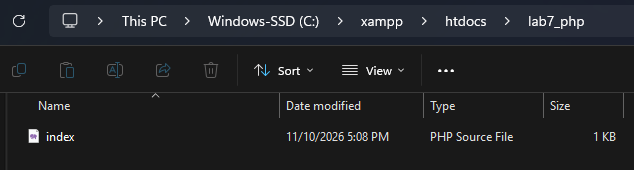

Isi index.php dengan code di bawah ini menggunakkan vscode :

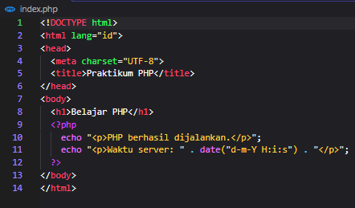

Lanjut akses dengan alamat local di browser dan jangan lupa nyalakan apache di xampp nya :

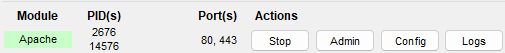

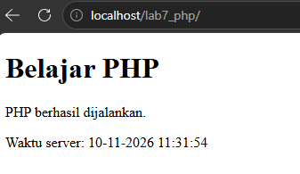

Buat variable, operator, dan percabangan di index.php

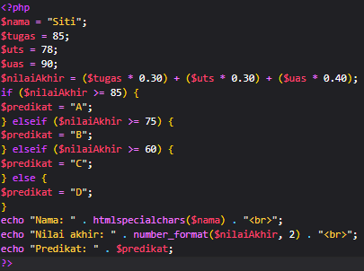

Hasil di local

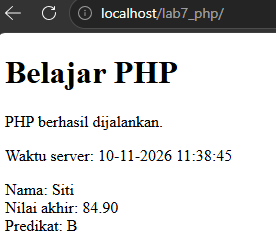

Coba beberapa perubahan disini saya ubah nilai dari variable nama, uts, dan juga uas sementara operator dan percabangan tidak di ubah :

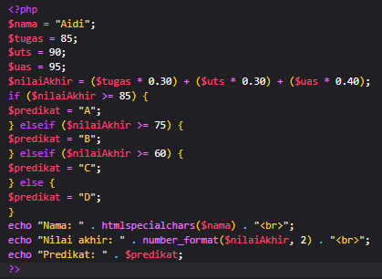

Hasil di local :

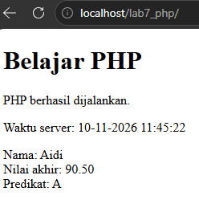

Lanjut buat daftar mahasiswa pakai array dan juga perulangan :

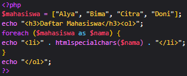

Hasilnya ;

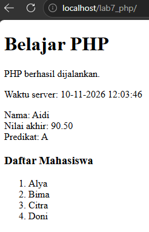

Tambahkan 3 nama lagi dafatar mahasiswa cukup tambahkan di array nya aja :

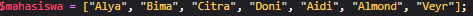

Hasilnya :

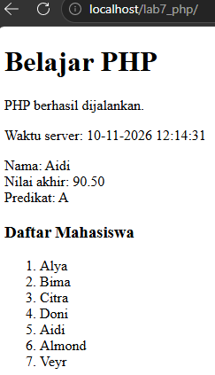

Lalu buat function, disini saya menambahkan function untuk menghitung luas persegi Panjang seperti yang di perintahkan di modul praktikum, sekalian tambahin \<br\> di echo pertama supaya luas persegi panjang turun ke baris bawah :

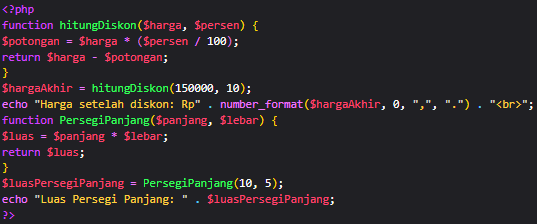

Hasilnya :

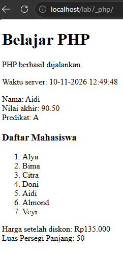

Memproses from dengan get

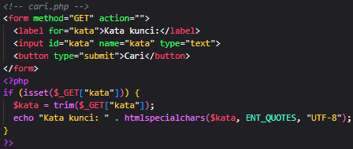

Hasil setelah mengisi formnya :

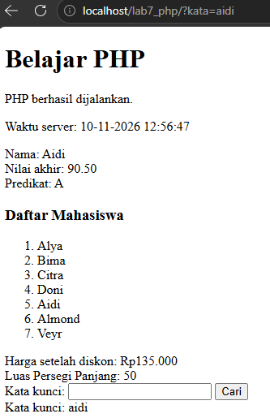

Memproses form dengan post :

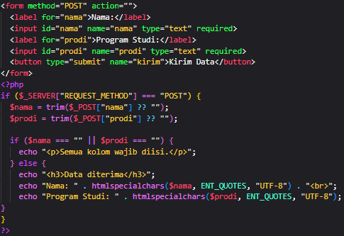

Pengolahan data sederhana :

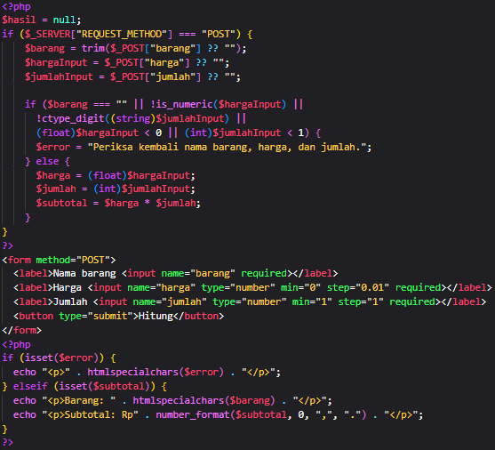

Hasil setelah mengisi formnya (harga integer, jumlah integer) :

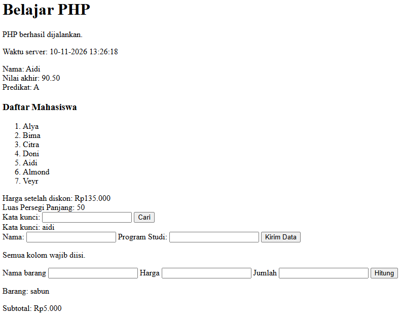

Ketika harga minus :

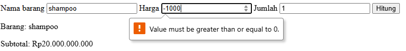

Ketika jumlah minus :

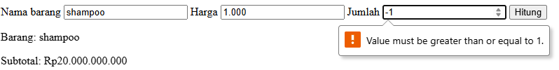

Ketika jumlah yang di masukkan desimal :

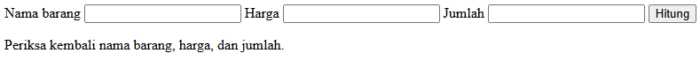

Ketika harga yang di masukkan desimal(otomatis di bulatkan ke angka terdekat misalkan 1.8 maka di bulatkan ke 2) :

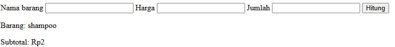

## MINI PROJECT

Php variable dan validasi :

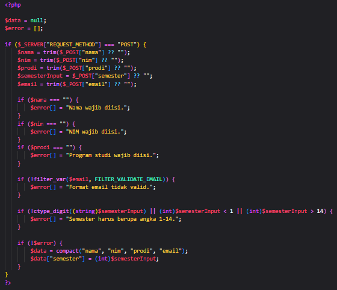

Bagian form html dan code sisanya :

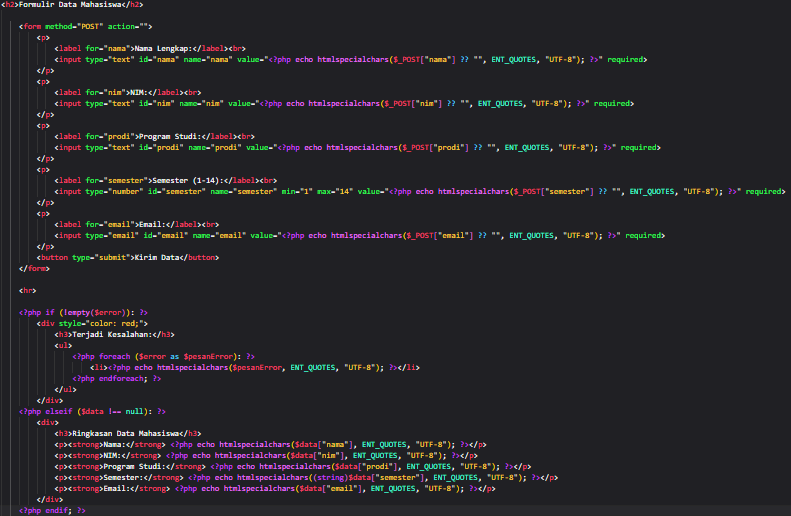

Hasilnya
saya akan coba isi dengan data diri saya sendiri :

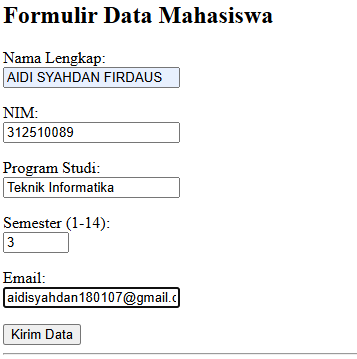

Ketika di kirim :

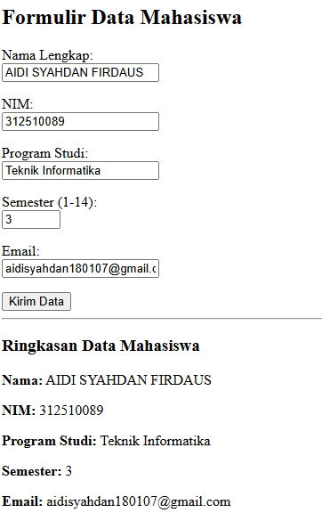

## PERTANYAAN EVALUASI

### Perbedaan Pemrosesan Client-Side dan Server-Side

**Client-side:** Proses dijalankan di sisi browser pengguna (seperti HTML, CSS, dan JavaScript).

**Server-side:** Proses dijalankan di komputer server (menerima permintaan, memproses data/logika aplikasi, lalu mengirimkan respons akhir berupa HTML ke browser).

### Alasan File PHP Harus Dijalankan Melalui Web Server

File PHP bersifat server-side, sehingga kodenya harus dieksekusi terlebih dahulu oleh mesin PHP pada web server (seperti Apache/Laragon/XAMPP). Jika dibuka langsung dengan klik ganda tanpa web server, browser hanya akan memuat kode PHP sebagai teks mentah tanpa menjalankan logikanya.

### Fungsi Tanda $ pada Variabel PHP

Tanda $ berfungsi sebagai penanda atau awalan wajib untuk mendeklarasikan dan memanggil nama variabel di dalam PHP.

### Perbedaan Metode GET dan POST

**GET:** Mengirim data melalui parameter URL, nilainya terlihat jelas pada alamat browser, dan digunakan untuk permintaan yang tidak mengubah data (misalnya formulir pencarian).

**POST:** Mengirim data melalui request body, nilainya tidak tampil di URL, dan lazim digunakan untuk pengiriman data formulir atau data sensitif.

### Alasan Input Pengguna Perlu Divalidasi di Sisi Server

Validasi di sisi client (seperti atribut HTML required) hanya membantu kenyamanan pengguna dan mudah dilewati atau dimanipulasi. Validasi server-side adalah pemeriksaan utama yang wajib dilakukan untuk menjamin integritas data serta keamanan aplikasi.

### Fungsi htmlspecialchars()

Fungsi ini digunakan untuk mengonversi karakter khusus menjadi entitas HTML saat menampilkan kembali data dari formulir. Tujuannya adalah mencegah dan mengurangi risiko serangan injeksi HTML/script (XSS).

### Manfaat Penggunaan Function

Function memungkinkan pembungkusan blok logika agar kode dapat dipanggil kembali (reusable) tanpa perlu menulis ulang. Hal ini membuat struktur program menjadi lebih rapi, terorganisir, dan mudah dikelola.
